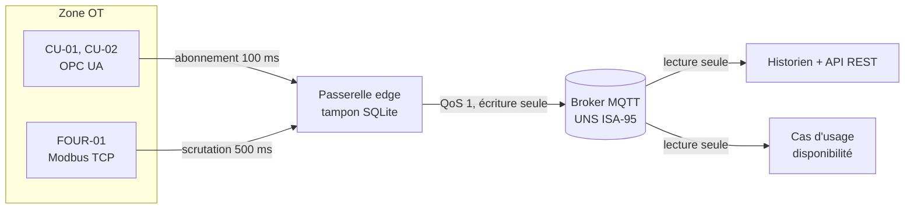
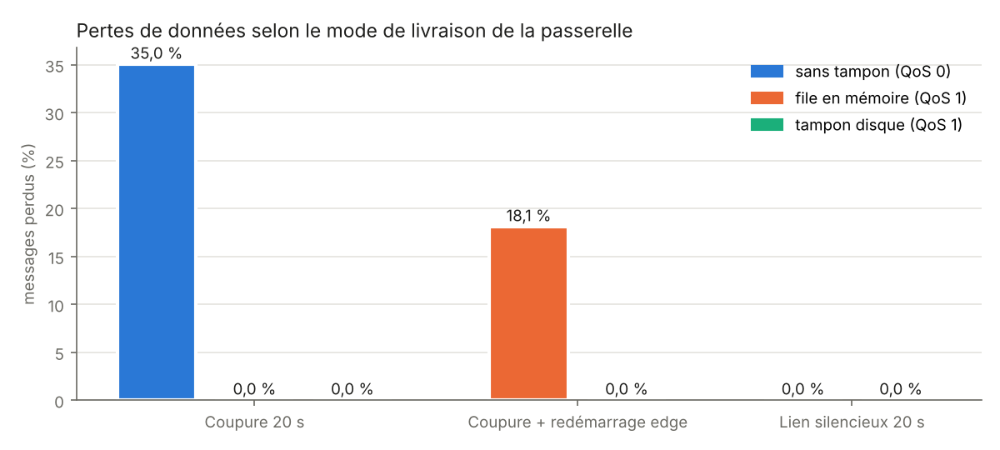
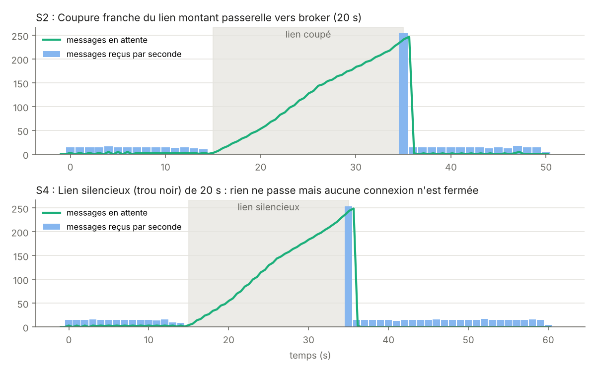

# LAB industriel logiciel : OPC UA, Modbus, passerelle edge et Unified Namespace

[](https://github.com/Abderrahmane-BOULAMI/industrial-lab-uns/actions/workflows/tests.yml)

Avant de brancher une nouvelle chaîne de données sur un atelier, il faut savoir comment elle se comporte quand
le réseau tombe, quand un automate ne répond plus ou quand quelqu'un tente d'écrire là où il ne devrait pas. Ce
dépôt est un **LAB R&D industriel en logiciel** qui permet de le vérifier sur un portable ou dans la CI :

- **des équipements simulés** : deux centres d'usinage derrière un vrai serveur **OPC UA**, un four de traitement
  thermique derrière un vrai automate **Modbus TCP** ;
- **une passerelle edge** pilotée par un fichier de configuration, qui publie dans un **Unified Namespace MQTT**
  organisé selon **ISA-95**, avec qualité, horodatage source, numéro de séquence et **tampon disque** ;
- **un broker sécurisé** (pas d'anonyme, mots de passe hachés, droits par topic), **un historien** qui dédoublonne
  et valide chaque message, et **une API REST** ;
- **un cas d'usage** (disponibilité et production des machines) calculé à partir de l'UNS seul ;
- **8 scénarios de test** avec critères d'acceptation, un **proxy d'injection de défauts** sur chaque conduit et une
  **grille de maturité** ;
- **la documentation** pour passer au LAB physique puis à l'industrialisation.

Tout est simulé : aucun automate ni machine réelle n'a été testé. Les protocoles, eux, sont réels (bibliothèques
`asyncua`, `pymodbus`, `paho-mqtt`, `amqtt`) : on peut remplacer un simulateur par un équipement sans changer la
passerelle.

## Architecture



Détails : [architecture](docs/architecture.md), [spécifications d'interfaces](docs/specifications_interfaces.md)
(arborescence UNS, contrat de message, carte des nœuds OPC UA et des registres Modbus, droits, API).

Exemple de message publié sur `entreprise/site-lab/usinage/ligne-1/cellule-5axes/CU-01/charge-broche` :

```json
{"v": 54.2, "ts": 1761040000123, "q": "GOOD", "u": "%", "src": "opcua:ns=2;s=CU-01.SpindleLoad", "gw": "edge-gw-01", "seq": 1842}
```

## Résultats des scénarios

Scénarios joués en temps réel par `experiments/run_all.py` (environ 12 minutes). Les chiffres ci-dessous viennent
de [`results/summary.json`](results/summary.json).

| Scénario | Mode | Messages | Perdus | Rattrapage après rétablissement | Verdict |
|---|---|---|---|---|---|
| S1 nominal, 120 s | tampon disque | 1 752 | 0 | | réussi |
| S2 coupure du lien montant, 20 s | sans tampon (QoS 0) | 711 | **249 (35,0 %)** | | échec attendu |
| | file en mémoire | 711 | 0 | 0,9 s | réussi |
| | **tampon disque** | 711 | 0 | 0,9 s | réussi |
| S3 coupure + redémarrage brutal de l'edge | file en mémoire | 686 | **124 (18,1 %)** | | échec |
| | **tampon disque** | 686 | 0 | 1,3 s | réussi |
| S4 lien silencieux, 20 s | file en mémoire | 864 | 0 | 1,1 s | réussi |
| | **tampon disque** | 861 | 0 (95 doublons éliminés) | 0,9 s | réussi |
| S5 réseau lent (200 ms + gigue 100 ms), 30 s | tampon disque | 712 | 0 | | réussi, latence max 419 ms |
| S6 perte de l'automate Modbus, 15 s | tampon disque | 540 | 0 | | détection 2,6 s, reprise 0,1 s |
| S7 perte du serveur OPC UA, 15 s | tampon disque | 544 | 0 | | détection 0,05 s, reprise 0,1 s |
| S8 sécurité | | | | | 6 contrôles sur 6 |



Ce que montrent ces chiffres :

1. **Sans tampon, une coupure de 20 s coûte 35 % des données de la fenêtre étudiée.** La file en mémoire du
   client MQTT suffit tant que la passerelle ne redémarre pas ; **si l'edge redémarre pendant la coupure, elle perd
   18 % des messages**. Seul le tampon disque (un message n'est effacé qu'après accusé de réception du broker) ne
   perd rien dans les trois cas.
2. **Le prix du tampon disque** : environ 7 ms de latence médiane en plus (57 ms contre 50 ms en S2) et des
   **doublons** après un lien silencieux (95 en S4), parce que la livraison est « au moins une fois ». L'historien
   les élimine grâce au couple (passerelle, numéro de séquence) : c'est une règle à imposer à tout consommateur.
3. **Latence de bout en bout en nominal : 56 ms en médiane, 109 ms au 95e centile**, mesurée sur chaque message
   entre l'horodatage source et la réception par l'historien. L'essentiel vient de l'intervalle de publication
   OPC UA (100 ms).
4. **Une source perdue est signalée** : chaque variable passe en qualité `BAD` (valeur nulle) et le topic `_sante`
   passe à `DOWN`, puis le flux repart seul. Pour Modbus, la détection prend 2,6 s (deux scrutations en échec),
   à régler selon le besoin.
5. **Le cas d'usage calculé depuis l'UNS seul** retrouve la disponibilité des deux machines à 0,001 point près et
   le même nombre de pièces que le simulateur (S1). C'est une vérification de la chaîne (aucun changement d'état
   perdu ni mal horodaté), pas une preuve sur des données réelles : il n'y a eu que 8 changements d'état en 120 s.



### Sécurité (S8)

| Contrôle | Résultat |
|---|---|
| Connexion anonyme au broker | refusée |
| Mot de passe erroné | refusé |
| Fausse mesure publiée par un compte lecteur | jamais reçue (ACL) |
| Abonnement à l'UNS par le compte passerelle | refusé (moindre privilège) |
| Messages hors contrat | rejetés par l'historien (2 sur 2) |
| Stockage des mots de passe | empreintes argon2 uniquement, générés à chaque lancement |

Ce qui manque avant un déploiement (TLS, sécurité OPC UA, journalisation) est listé dans
[docs/cybersecurite.md](docs/cybersecurite.md).

### Grille de maturité

| Niveau | Nom | Atteint |
|---|---|---|
| 1 | Démonstrateur | oui |
| 2 | Robuste aux défauts réseau | oui |
| 3 | Sécurisé (base) | oui |
| 4 | Exploitable et reproductible | oui |
| 5 | Validé sur équipements réels | **non** : demande des essais sur le LAB physique |

## Limites

- **Aucun équipement réel.** Les serveurs OPC UA et Modbus sont réels mais les machines sont simulées ; le
  comportement d'un vrai automate (charge, limites d'abonnements, coupures partielles) reste à tester.
- **Tout tourne sur une seule machine** : les défauts réseau sont injectés par un proxy logiciel, pas par un vrai
  réseau industriel (commutateurs, VLAN, pare-feu).
- **Pas de TLS ni de sécurité OPC UA dans les scénarios** ; la configuration cible est documentée, non testée.
- **Le déploiement Docker** (`deploy/docker-compose.yml`, Mosquitto) est fourni mais n'a pas été exécuté dans
  l'environnement de développement ; la CI teste la version en un seul processus.
- **Tampon non borné** : sa taille maximale et le comportement à saturation restent à définir selon la durée de
  coupure à couvrir.
- La détection d'un lien silencieux dépend du keepalive MQTT (5 s ici) ; elle n'est pas mesurée séparément.

## Lancer le projet

```bash
pip install -r requirements.txt
python -m labuns check            # valide config/lab.yaml
pytest -q                         # 16 tests, dont le LAB complet en temps raccourci (environ 3 min)
python experiments/run_all.py     # tous les scénarios en temps réel, tableaux et figures (environ 12 min)
python -m labuns lab              # LAB en direct, broker local (Ctrl+C pour arrêter)
```

Version conteneurs (broker Mosquitto, simulateurs, passerelle, historien et API sur `localhost:8000/docs`) :

```bash
cd deploy && cp .env.example .env   # puis choisir les mots de passe
docker compose up --build
```

## Ajouter un équipement

Tout se fait dans [`config/lab.yaml`](config/lab.yaml) : ajouter un bloc OPC UA (nœuds et noms UNS) ou une carte de
registres Modbus (adresse, échelle, unité), puis `python -m labuns check`. La validation refuse les topics en double,
les adresses en double, un point d'accès mal formé ou un automate sans registre de battement.

## Organisation

```
config/lab.yaml            équipements, UNS, passerelle, historien
labuns/plant.py            modèle de l'atelier (états machines, four) et vérité terrain
labuns/simulators.py       serveur OPC UA et automate Modbus TCP simulés
labuns/gateway.py          passerelle edge : OPC UA, Modbus, qualité, tampon SQLite, santé
labuns/uns.py              arborescence ISA-95 et contrat des messages
labuns/historian.py        historien (validation, dédoublonnage) et API REST
labuns/faultproxy.py       injection de défauts réseau (coupure, trou noir, latence)
labuns/scenarios.py        exécution des scénarios et indicateurs
labuns/security.py         contrôles de sécurité (S8)
labuns/maturity.py         grille de maturité
labuns/usecases.py         disponibilité et production depuis l'UNS
scenarios/                 S1 à S7 en YAML (événements datés et critères d'acceptation)
docs/                      architecture, interfaces, cybersécurité, industrialisation, catalogue de cas d'usage
deploy/                    Dockerfile, docker-compose, configuration Mosquitto
results/                   summary.json, grille de maturité, figures
```

Licence MIT.
