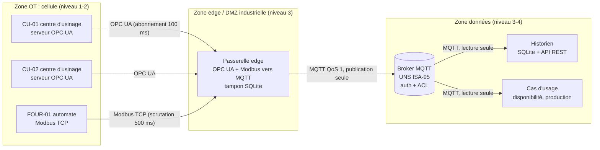

# Architecture fonctionnelle et technique du LAB

## Objectif

Disposer d'un environnement où l'on peut brancher, tester et casser une chaîne de données industrielle
**avant** de la déployer en atelier : équipements, protocoles, passerelle edge, Unified Namespace (UNS),
plateforme de données et cas d'usage. Le même code tourne :

- en **simulation complète** sur un portable ou dans la CI (ce dépôt) ;
- en **LAB physique**, en remplaçant les simulateurs par de vrais automates et machines (même configuration,
  mêmes scénarios).

## Vue fonctionnelle

| Fonction | Rôle | Composant du dépôt |
|---|---|---|
| Acquisition | Lire les équipements dans leur protocole natif | `gateway.py` (OPC UA par abonnement, Modbus par scrutation) |
| Contextualisation | Nommer chaque donnée dans l'arborescence ISA-95, ajouter unité, qualité, horodatage | `uns.py` |
| Transport | Publier vers l'UNS, sans perte malgré les coupures | `gateway.py` (tampon SQLite, QoS 1) |
| Diffusion | Point unique d'échange OT/IT, droits par topic | broker MQTT (amqtt ici, Mosquitto en déploiement) |
| Stockage et accès | Historiser, dédoublonner, exposer par API | `historian.py` (SQLite + API REST FastAPI) |
| Valorisation | Calculer un indicateur de pilotage depuis l'UNS seul | `usecases.py` (disponibilité, production) |
| Validation | Scénarios de test, critères, grille de maturité | `scenarios.py`, `security.py`, `maturity.py` |

## Vue technique

Dans le LAB logiciel, un **proxy d'injection de défauts** (`faultproxy.py`) est placé sur chacun des trois
conduits (OPC UA, Modbus, MQTT). Il permet de couper un lien, de le rendre silencieux ou de le ralentir pendant un
scénario, ce qui est difficile à faire proprement sur du matériel.

## Choix et justification

| Choix | Pourquoi | Alternative à évaluer dans le LAB physique |
|---|---|---|
| MQTT + UNS ISA-95 | Découple producteurs et consommateurs ; un nouveau cas d'usage s'abonne sans toucher aux machines | Sparkplug B (états de naissance et de mort normalisés) |
| OPC UA par abonnement | Pas de scrutation inutile ; horodatage source fourni par la machine | Lecture cyclique si le serveur limite les abonnements |
| Modbus par scrutation + battement | Modbus ne pousse rien ; le battement détecte un automate figé | Passerelle protocolaire du constructeur |
| Tampon SQLite côté edge | Survit à un redémarrage ; un message n'est effacé qu'après accusé de réception | File persistante du client MQTT, Kafka à l'edge (lourd) |
| Numéro de séquence par passerelle | Rend les pertes mesurables et les doublons éliminables (livraison « au moins une fois ») | Identifiant unique par message |
| Historien SQLite | Suffisant pour le LAB, zéro installation | TimescaleDB, InfluxDB, plateforme data du groupe |

## Flux de données et horodatage

1. La machine écrit une valeur ; OPC UA fournit son `SourceTimestamp`. Pour Modbus, l'horodatage est l'instant de
   lecture par la passerelle (Modbus n'en transporte pas).
2. La passerelle ne publie que les **changements** (bande morte configurable par variable).
3. La passerelle attribue un numéro de séquence, écrit le message dans son tampon, l'envoie en QoS 1 et ne l'efface
   qu'à réception de l'accusé du broker.
4. L'historien valide le contrat du message, ignore les doublons `(passerelle, séquence)` et enregistre l'instant de
   réception : la latence de bout en bout est mesurée sur chaque message.

## Passage au LAB physique

Remplacer les simulateurs ne demande que la configuration : point d'accès OPC UA réel, identifiants de nœuds,
adresse et carte des registres Modbus de l'automate. Les scénarios S2 à S7 se rejouent tels quels en remplaçant le
proxy logiciel par une action réelle (débrancher un câble, arrêter un automate, couper l'alimentation de l'edge).
